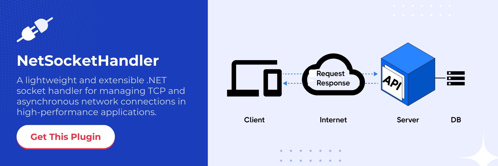

# NetSocketHandler

### A powerful, flexible .NET WebSocket manager for seamless connection handling, intelligent routing, and real-time broadcasting



## 📦 Quick Installation

**NuGet CLI:**
```bash
dotnet add package NetSocketHandler
```

**Package Manager Console:**
```bash
Install-Package NetSocketHandler
```

## ✨ Key Features

🔗 **Smart Connection Management** - Effortlessly add, remove, and organize WebSocket connections with unique identifiers  
🎯 **Precision Messaging** - Send targeted messages to specific clients or broadcast to all active connections  
🏷️ **Flexible Identification** - Assign custom identifiers for organized, scalable client communication  
⚡ **High Performance** - Optimized for real-time applications with minimal overhead  
🧪 **Testable Architecture** - Built with dependency injection support for clean, maintainable code  

## 🛠️ Usage Examples

### 1. **Connection Management Made Simple**

The `ConnectionManager<TData>` provides intuitive WebSocket connection management:

```csharp
using NetSocketHandler.Interface;
using NetSocketHandler.Implementation;
using System.Net.WebSockets;

// Initialize the connection manager
var connectionManager = new ConnectionManager<string>();

// Add a new WebSocket connection
connectionManager.AddConnection("user_123", webSocket, "john_doe");

// Send targeted message to specific user
await connectionManager.SendDataToIdentifier("john_doe", "Welcome back, John!");

// Broadcast announcement to all connected clients
await connectionManager.SendDataAsync("🎉 New feature released!");
```

### 2. **Streamlined Connection Handling**

Use `ConnectionHandler<TData>` for seamless WebSocket connection processing:

```csharp
using NetSocketHandler;

// Create connection handler
var connectionHandler = new ConnectionHandler<string>();

// Handle incoming WebSocket connection
await connectionHandler.HandleConnectionAsync(webSocket, "session_456");
```

### 3. **Dependency Injection Ready**

Built for modern .NET applications with clean architecture:

```csharp
public class ChatService
{
    private readonly IConnectionManager<string> _connectionManager;

    public ChatService(IConnectionManager<string> connectionManager)
    {
        _connectionManager = connectionManager;
    }

    public async Task SendChatMessage(string message, string roomId)
    {
        // Send to specific room
        await _connectionManager.SendDataToIdentifier(roomId, message);
    }

    public async Task BroadcastSystemMessage(string message)
    {
        // Notify all connected users
        await _connectionManager.SendDataAsync($"📢 System: {message}");
    }
}
```

## 🏗️ Architecture Overview

**Core Interfaces:**

🔧 `IConnectionManager<TData>` - Contract for connection management operations  
⚡ Support for generic data types for flexible message handling  
🛡️ Thread-safe operations for concurrent WebSocket connections  

**Key Operations:**

➕ Add/Remove connections dynamically  
🔍 Retrieve connections by ID or custom identifier  
📤 Send messages to individual or multiple connections  
📡 Broadcast capabilities for real-time updates  

## 🎯 Perfect For

💬 **Real-time Chat Applications**  
🔔 **Live Notifications Systems**  
🤝 **Collaborative Tools**  
🎮 **Gaming Servers**  
🏠 **IoT Device Communication**  
📈 **Trading Platforms**  

## Code Contributors


⭐ **Star this repository if NetSocketHandler helped your project!**